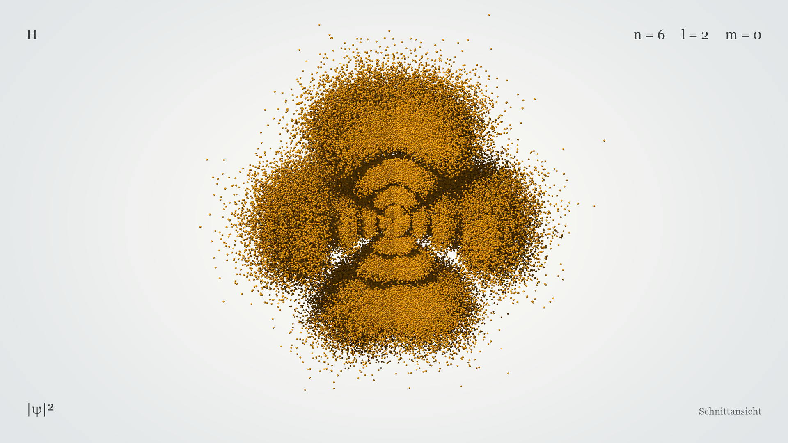

# atom-simulator

Vollständige Wasserstofforbitale als goldene 3D-Punktwolken. Die Positionen werden
aus der normierten Wahrscheinlichkeitsdichte der Wasserstoff-Wellenfunktion
gezogen. Ein eigener OpenGL-Renderer stellt jede Probe als kleine beleuchtete
Kugel dar, mit Tiefenverdeckung, Schatten und einer zuschaltbaren Schnittansicht.



**Version 0.1:** interaktiver Betrachter, PNG-Export und ruhiger MP4-Kameraflug.
Standard: `n=6, l=2, m=0`, 450.000 Punkte, goldene Darstellung auf hellem Grund.
Das Programm benötigt kein Manim, Blender oder separates FFmpeg-Programm.

## Starten

Voraussetzungen: Python **3.11 oder neuer**, ein Desktop mit **OpenGL 3.3** und
aktuelle Grafiktreiber. Der getestete Rechner verwendet Windows und eine
NVIDIA RTX 4070 SUPER. Die wissenschaftlichen Tests benötigen keine Grafikkarte.

Im Projektordner unter Windows/PowerShell:

```powershell
python -m venv .venv
.\.venv\Scripts\python.exe -m pip install -e .
.\.venv\Scripts\python.exe -m atom_simulator view
```

Alternativ richtet `./Start.ps1` die Umgebung beim ersten Aufruf ein und öffnet
den Betrachter. `./Start.ps1 render` exportiert die Standardvorschau.

Unter macOS/Linux heißen die entsprechenden Aufrufe `.venv/bin/python`.
Der interaktive Betrachter verwendet GLFW. Der Export erzeugt einen unsichtbaren
OpenGL-Kontext; auf einem Linux-Server ohne Desktop ist dafür gegebenenfalls
eine gesonderte EGL-/Xvfb-Einrichtung erforderlich. Dieser Serverbetrieb ist
kein getesteter Bestandteil der ersten Version.

## Bedienung

| Eingabe | Wirkung |
| --- | --- |
| Linke Maustaste ziehen | Ansicht drehen |
| Mausrad | Vergrößern/verkleinern |
| `Leertaste` | Langsame Kameradrehung starten/stoppen |
| `C` | Geometrischen Ausschnitt ein-/ausblenden |
| `B` | Hellen oder schwarzen Hintergrund wählen |
| `R` | Kamera zurücksetzen |
| `1` / `2` / `3` / `4` | 1s / 2p mit m=0 / 3d mit m=0 / 6d mit m=0 |
| `Esc` | Fenster schließen |

Beliebige zulässige Zustände bis `n=12` lassen sich beim Start wählen:

```powershell
.\.venv\Scripts\python.exe -m atom_simulator view --n 4 --l 3 --m 2
```

Jeder Zustand wird automatisch auf seinen eigenen Begrenzungsradius eingepasst.
Die Bildschirmgrößen verschiedener Presets sind deshalb **kein gemeinsamer
physikalischer Maßstab**. Die Koordinaten selbst behalten ihre Einheit `a_mu`;
der Darstellungsmaßstab steht in den Exportmetadaten.

## Bilder und Video

20 Sekunden, 1920 × 1080, 30 Bilder/s, ohne Ton:

```powershell
.\.venv\Scripts\python.exe -m atom_simulator render --duration 20 --output outputs/orbital-preview.mp4
```

Der Clip beginnt mit der vollständigen Wolke. Anschließend öffnet sich langsam
ein 110°-Keil, während die Kamera einen kleinen Bogen beschreibt. Zum Schluss
bleibt das Bild stehen. Der Zusatz **Schnittansicht** kennzeichnet die Ausblendung.

Einzelbild und eine Variante ohne Schnitt:

```powershell
.\.venv\Scripts\python.exe -m atom_simulator image --output outputs/orbital.png
.\.venv\Scripts\python.exe -m atom_simulator render --no-cutaway --background black
```

Wichtige Optionen: `--n`, `--l`, `--m`, `--points`, `--seed`, `--width`,
`--height`, `--bead-radius`, `--background light|black`, `--no-labels`.
Für Exporte kommt `--supersample 1|2|3` hinzu: Standard `2` rendert in doppelter
Breite/Höhe und verkleinert das Bild für glatte Kanten. Bei schwächerer Hardware
zunächst `--points 100000 --supersample 1 --width 1280 --height 720` verwenden.
Alle Optionen stehen unter `python -m atom_simulator render --help`.

Zu jedem PNG/MP4 entsteht eine JSON-Datei mit Quantenzahlen, Seed,
Integrationsnormen, erfasster Wahrscheinlichkeit, Maßstab und Renderparametern.
Videos entstehen zunächst als `*.partial.mp4`; erst nach erfolgreichem Encoding
wird die endgültige Datei ersetzt. Große Exporte und die Python-Umgebung werden
nicht in Git eingecheckt.

## Physik und Abgrenzung

Berechnet wird `psi_nlm = R_nl(r) * Y_lm(theta, phi)` mit vollständigem Radialteil
und **komplexen** Kugelflächenfunktionen. Das Sampling berücksichtigt das
Volumenelement: `r² |R|²`, die Verteilung in `cos(theta)` und einen gleichverteilten
Azimut. Der numerische Grenzradius lässt eine Restwahrscheinlichkeit von `1e-8`
außerhalb. Diese Grenze ist keine Atomoberfläche.

Die Punkte sind mögliche Ortsmessergebnisse für **ein Elektron**. Ihre Positionen
bleiben während des Clips fest. Bewegt werden Kamera und Schnittöffnung. Das
Programm simuliert in dieser Version weder Elektronenbahnen noch Bohmsche
Trajektorien. Gold und Licht kodieren auch kein Vorzeichen der Wellenfunktion.
Eine Änderung von Punktgröße/Beleuchtung verändert die Darstellung, nicht die
berechnete Verteilung.

Die Optik orientiert sich an minutephysics' [A Better Way To Picture Atoms](https://www.youtube.com/watch?v=W2Xb2GFK2yc).
Die dort erwähnten Bohmschen Trajektorien sind ein anderer Bewegungsmodus.
Hier entstand eigener Python-/GLSL-Code; es wurden keine Videoframes übernommen.
Herleitung, Einheiten, Knoten und Primärquellen stehen in [docs/physics.md](docs/physics.md).

## Codeaufbau

Der Code verwendet explizite Zwischenschritte, Typangaben und kleine Funktionen.
Die Datenstrukturen beschreiben einen Zustand, eine Punktwolke und Renderoptionen.
Die Python-Implementierung enthält keine verschachtelten Schleifen. NumPy/SciPy
bearbeiten die Punktmengen als Arrays; die Grafikkarte zeichnet sie gesammelt.

| Modul | Verantwortung |
| --- | --- |
| `physics.py` | Normierte Wellenfunktionen, Quantenzahlen, Knoten |
| `sampling.py` | Getrennte inverse Verteilungsfunktionen und reproduzierbare Stichprobe |
| `camera.py` | Projektionsmatrizen und ruhiger Kameraablauf |
| `renderer.py`, `shaders.py` | GPU-Ressourcen, Kugelpunkte, Schatten, Beschriftung |
| `viewer.py` | Fenster und Maus-/Tastatursteuerung |
| `export.py` | PNG, H.264 und Metadaten |
| `cli.py` | Eingabeprüfung und Programmeinstieg |

## Prüfen und weiterentwickeln

```powershell
.\.venv\Scripts\python.exe -m pip install -e ".[dev]"
.\.venv\Scripts\python.exe -m ruff check .
.\.venv\Scripts\python.exe -m unittest discover -s tests -v
```

Die Tests vergleichen unter anderem analytische 1s-/2p-Lösungen, Normierung,
Momente, Radialknoten, Stichprobenverteilungen, alle unterstützten radialen und
polaren Verteilungen, Kamerageometrie und Exportfehler. GitHub Actions führt
dieselben CPU-Tests und die Codeprüfung unter Windows/Linux aus. Die eigentliche
Grafikausgabe wird lokal mit einer OpenGL-Grafikkarte geprüft.

Die für die erste Windows-Vorschau verwendeten Bibliotheksversionen stehen in
`requirements-tested.txt`; die unterstützten Bereiche stehen in `pyproject.toml`.
